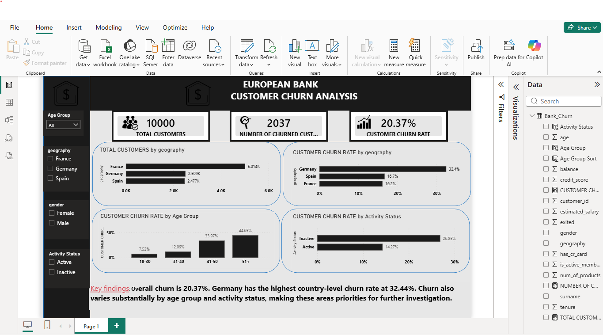

# European Bank Customer Churn Analysis

## Project Overview

Customer churn is an important business challenge for banks because losing customers can affect revenue, customer lifetime value, and long-term growth.

This project analyses customer data to identify patterns associated with bank customer churn. Using Python, PostgreSQL, and Power BI, I explored customer demographics, account activity, product usage, account balances, and geographic differences to identify customer segments that may require further investigation.

## Business Problem

The bank wants to understand which customer segments experience higher churn so that it can investigate potential retention opportunities and make more informed business decisions.

### Key Business Questions

- What percentage of customers have left the bank?
- Which geographic markets have the highest churn rates?
- How does churn vary across customer age groups and gender?
- Are inactive customers more likely to churn?
- Does the number of products held relate to churn?
- Which customer segments should the bank investigate first?

## Tools and Technologies

- **Python:** Data exploration, data-quality checks, statistical summaries, and visualisation.
- **PostgreSQL:** SQL analysis, aggregations, common table expressions (CTEs), CASE statements, and window functions.
- **Power BI:** Interactive dashboard development, DAX measures, calculated columns, KPI cards, charts, and slicers.
- **GitHub:** Project documentation, version control, and portfolio presentation.

## Analytical Process

1. **Data inspection:** Examined the dataset structure, column types, and customer records.
2. **Data quality:** Checked for missing values, duplicate rows, and duplicate customer IDs.
3. **Exploratory analysis:** Investigated churn across geography, age, gender, activity status, product usage, balances, salary, credit cards, and tenure.
4. **SQL analysis:** Reproduced key metrics and used CTEs, conditional logic, aggregations, ranking, and window functions.
5. **Power BI reporting:** Built an interactive dashboard with KPI cards, comparison charts, and slicers.
6. **Business interpretation:** Identified high-churn segments and potential areas for further investigation.

## Key Findings

The dataset contains 10,000 customers, of whom 2,037 have exited the bank.

- **Overall churn rate:** 20.37%.
- **Geography:** Germany has the highest churn rate at 32.44%, compared with 16.67% in Spain and 16.15% in France.
- **Age:** Customers aged 51+ have the highest observed churn rate at 44.65%, followed by customers aged 41–50 at 33.97%.
- **Gender:** Female customers have a churn rate of 25.07%, compared with 16.46% for male customers.
- **Activity status:** Inactive customers have a churn rate of 26.85%, compared with 14.27% for active customers.
- **Product usage:** Churn is particularly high among customers holding three or four products. These groups are small, so the results should be interpreted cautiously.

## Business Recommendations

1. **Investigate churn in Germany:** Examine customer experience, pricing, service issues, competitor offerings, and other potential drivers.
2. **Review retention for older customers:** Explore customer needs and experiences among customers aged 41 and above.
3. **Re-engage inactive customers:** Test targeted engagement initiatives and measure whether they improve retention.
4. **Investigate multi-product customers:** Review product suitability, customer satisfaction, and possible service or product complexity issues.
5. **Monitor churn consistently:** Track churn rate and customer segments over time to evaluate retention initiatives.

These recommendations are hypotheses for further investigation. The analysis identifies associations, not proven causes of churn.

## Dashboard

The Power BI dashboard summarises customer churn through KPI cards, geographic comparisons, age-group analysis, gender analysis, activity status, and interactive slicers.

*Add a screenshot of the completed dashboard here.*
## Dashboard Preview
## Dashboard Preview

## Limitations

- The analysis is based on the available dataset and its recorded customer attributes.
- The findings are descriptive and do not establish causation.
- Some customer segments, especially those with three or four products, contain relatively few observations.
- Further analysis of customer behaviour over time and additional business context would help validate potential churn drivers.

## Conclusion

This project demonstrates how Python, SQL, and Power BI can be combined to investigate a business problem, identify customer segments with elevated churn, and communicate findings through an interactive dashboard.

The next step would be to validate potential churn drivers and evaluate targeted retention strategies using additional data.

## Skills Demonstrated

Exploratory Data Analysis | Data Quality Checks | SQL | PostgreSQL | Python | Pandas | Matplotlib | DAX | Power BI | Data Visualisation | Business Analysis | Data Storytelling
